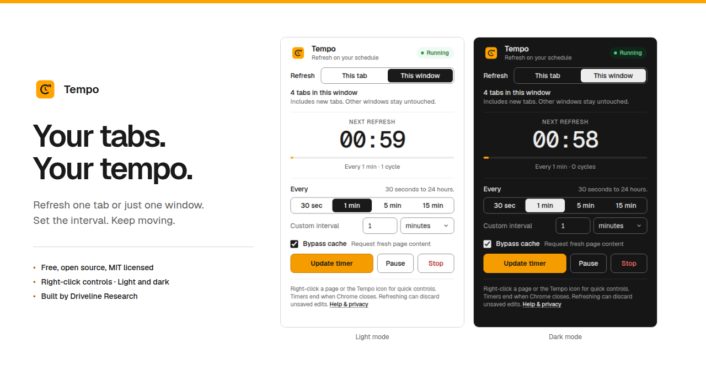
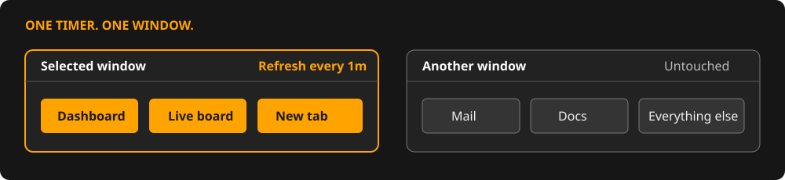

<div align="center">


# Tempo

**Your tabs. Your tempo.**

Refresh one tab or just one Chrome window on your schedule.

[](https://chromewebstore.google.com/detail/tempo-%E2%80%94-tab-window-refres/icbbmkelghjebpomabomndmlnjpdlcjd)

[MIT licensed](LICENSE) · [Source & downloads](https://github.com/drivelineresearch/tempo-refresh/releases) · [Build with natural language](docs/PROMPT-GUIDE.md)

<picture>
  <source media="(prefers-color-scheme: dark)" srcset="docs/assets/hero-dark.png">
  
</picture>

</div>

Tempo is a free, open-source Manifest V3 extension built by Driveline Research. Choose a tab or one window, set an interval, and close the popup. The timer keeps running. No account, payment, ads, telemetry, backend, page injection, or runtime dependencies.

## Install or build your own

**Use it:** [Install Tempo from the Chrome Web Store](https://chromewebstore.google.com/detail/tempo-%E2%80%94-tab-window-refres/icbbmkelghjebpomabomndmlnjpdlcjd), pin the icon, and open a website. Published version: **1.0.0**.

**Inspect or customize it:** clone this repository, open `chrome://extensions`, enable Developer mode, click Load unpacked, and select `extension/`. The existing runtime needs no build step or Node installation.

**Start from a prompt:** follow the [natural-language build guide](docs/PROMPT-GUIDE.md). It includes copy-and-paste prompts for behavior, visual design, testing, packaging, and documentation, so you can create your own version instead of installing our packages.

Prefer a ZIP? [Download the extension](https://github.com/drivelineresearch/tempo-refresh/releases/latest/download/tempo-refresh-1.0.0.zip), [source](https://github.com/drivelineresearch/tempo-refresh/releases/latest/download/tempo-refresh-source-1.0.0.zip), or [publisher kit](https://github.com/drivelineresearch/tempo-refresh/releases/latest/download/tempo-publisher-kit-1.0.0.zip). Extract an extension ZIP before selecting its folder in Load unpacked.

## One window means one window



| Control | What happens |
| --- | --- |
| **This tab** | The original tab keeps refreshing when you switch tabs or move it to another window. |
| **This window** | Its current tabs refresh, including new tabs. Move a tab out and it leaves that timer. Other windows stay untouched. |
| **Interval** | Choose 30 sec, 1 min, 5 min, or 15 min, or a custom interval from 30 seconds to 24 hours. |
| **Pause / Resume / Stop** | Pause clears the alarm; resume starts a fresh interval; stop removes the timer. |
| **Bypass cache** | Ask Chrome for fresh content rather than its cached copy. |
| **Right-click** | Use a webpage or the Tempo toolbar icon for presets, custom intervals, and timer controls. |

Badges show **ON** for a tab timer, **WIN** for a window timer, and **II** when paused. Starting a window timer replaces separate tab timers there. A timed tab moved into a covered window adopts that window's timer.

## Why choose Tempo

- **Free window refresh and cache bypass.** Both are included without registration or an upgrade.
- **A focused interface.** Two target choices, readable timer state, and the controls needed for refreshing. Light and dark themes follow your system preference.
- **A small access boundary.** Four permissions, no host permissions, no broad `tabs` permission, and no content scripts. The [privacy explanation](docs/PRIVACY.md) names what is accessed and stored.
- **Source you can inspect and rebuild.** Plain JavaScript, original graphics, reproducible packaging, MIT licensing, and a prompt guide are all here.
- **Window isolation backed by tests.** The browser suite opens separate windows and proves that the second window is untouched.

For this focused workflow, those are practical advantages over a registration-gated window feature or a broad monitoring suite. [Easy Auto Refresh](https://chromewebstore.google.com/detail/easy-auto-refresh/aabcgdmkeabbnleenpncegpcngjpnjkc) lists window refresh among its registration-only options. [Auto Refresh Plus](https://chromewebstore.google.com/detail/auto-refresh-plus-page-mo/hgeljhfekpckiiplhkigfehkdpldcggm) advertises 42 features, including monitoring, AI scripts, and account sync. [Tab Reloader](https://chromewebstore.google.com/detail/tab-reloader-page-auto-re/dejobinhdiimklegodgbmbifijpppopn?hl=en) offers policies, scripts, session restoration, and multi-window operations.

Those tools may suit advanced monitoring or faster intervals better. Tempo targets simple, deliberate refreshing. See the [source-backed comparison](docs/COMPARISON.md) for details; these are feature comparisons, not security findings.

## Privacy and practical limits

The permissions are `alarms`, `storage`, `contextMenus`, and `activeTab`. Selected tab titles/URLs stay in memory and are never saved or transmitted. Only interval/cache preferences persist locally; active jobs are session-only. Website reloads still make normal requests to those websites.

[Chrome alarms](https://developer.chrome.com/docs/extensions/reference/api/alarms) have a 30-second production floor and may be delayed on busy or sleeping devices. Tabs still loading are skipped. Timers end when Chrome closes or the extension is reloaded/updated/disabled. Refreshing can discard unsaved edits or repeat a form submission; pause before editing. Chrome's native tab-strip menu is outside the extension context-menu API.

## Develop and verify

Node 20+ and Python 3 are needed for development tools, not for using the extension.

```sh
npm ci --ignore-scripts
npx playwright install chromium
npm test
npm run check:docs
npm run test:browser
npm run package
```

The suite covers engine behavior, an actual 30-second timer with the popup closed, window membership, keyboard controls, and six light/dark accessibility scans. CI repeats the checks. Use the [development guide](docs/DEVELOPMENT.md) for Linux browser libraries, alternative Chrome executables, graphics regeneration, and packaging.

| Guide | What it covers |
| --- | --- |
| [Prompt guide](docs/PROMPT-GUIDE.md) | Build a similar extension with natural language. |
| [Architecture](docs/ARCHITECTURE.md) | Alarms, state, event ordering, and target identity. |
| [Privacy](docs/PRIVACY.md) | Permissions and local data handling. |
| [Testing](docs/TESTING.md) | Evidence and the limits of automated checks. |
| [Publishing](docs/PUBLISH.md) | Source releases and separate Store updates. |
| [Graphics](docs/assets/README.md) | README, screenshots, icons, and a social card. |
| [Contributing](CONTRIBUTING.md) | Changes, bug reports, and review expectations. |

[CLAUDE.md](CLAUDE.md) is the short canonical agent guide. [AGENTS.md](AGENTS.md) is its generated plain-Markdown counterpart. They follow the `claude-md-guide` approach: clear commands and contracts, with long runbooks linked separately.

## License and credits

Extension code, scripts, documentation, and original Tempo graphics are [MIT licensed](LICENSE). Bundled Geist fonts retain [SIL OFL 1.1](extension/fonts/OFL.txt). The styling was authored with Claude Opus 5.5 and checked in Chromium; the [design rationale](design/opus-design.md) is included.

Built by [Driveline Research](https://github.com/drivelineresearch). [Install Tempo](https://chromewebstore.google.com/detail/tempo-%E2%80%94-tab-window-refres/icbbmkelghjebpomabomndmlnjpdlcjd) · [Report an issue](https://github.com/drivelineresearch/tempo-refresh/issues)
